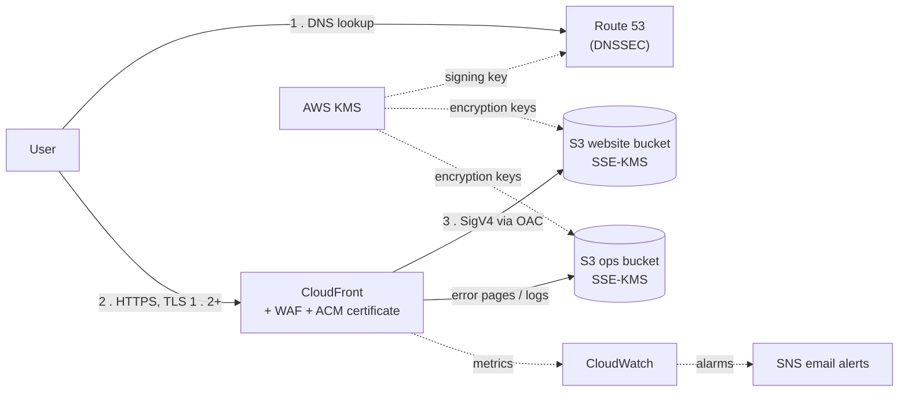
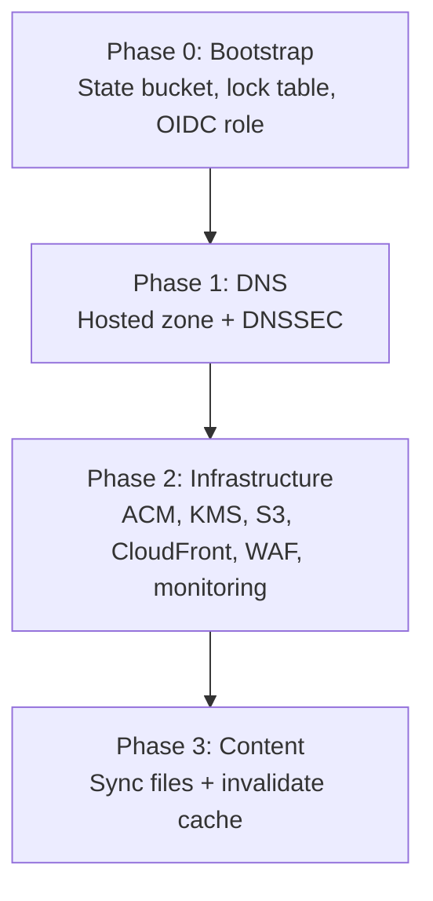
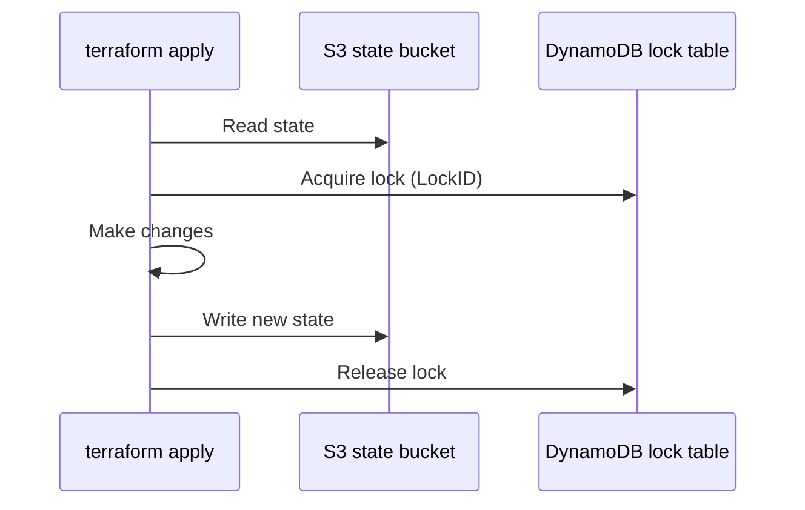
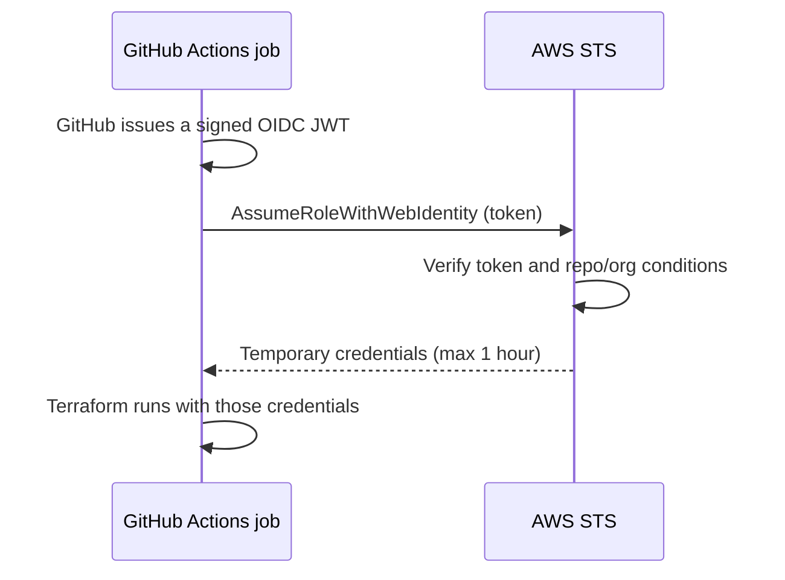
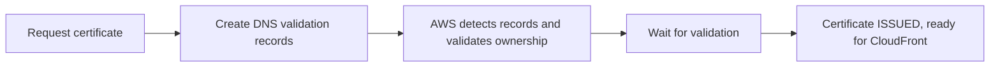

# Secure, Low-Latency Static Website on AWS with Terraform

**Route 53 (DNSSEC) · CloudFront · WAF · ACM (TLS) · KMS · S3 · GitHub Actions (OIDC)**

A production-grade, fully serverless static website hosted on AWS and provisioned entirely with Terraform. Traffic is
protected end to end: signed DNS, TLS in transit, KMS encryption at rest, a web application firewall at the edge, and
private origins reachable only through CloudFront.

---

## 1. Overview

### The challenge

Hosting a static site on a traditional server means patching the OS, configuring a web server, renewing certificates,
and scaling capacity. None of this adds value for static content.

### The solution

This project replaces that overhead with managed AWS services:

| Role                                    | Service                            |
|-----------------------------------------|------------------------------------|
| **Store** website files                 | Amazon S3 (private, KMS-encrypted) |
| **Cache and serve** globally over HTTPS | Amazon CloudFront                  |
| **Route** the custom domain             | Amazon Route 53 (DNSSEC-signed)    |
| **Issue** TLS certificates              | AWS Certificate Manager (ACM)      |
| **Protect** against web attacks         | AWS WAF                            |
| **Encrypt** data and sign DNS           | AWS KMS                            |
| **Observe** and alert                   | CloudWatch, SNS                    |

The result is a serverless, highly available pattern with no EC2 instances to manage, secured at every layer.

---

## 2. Architecture


### 2.1 Request flow



1. **DNS resolution.** The browser asks Route 53, which answers through an alias A record. DNS responses are signed with
   a KMS-backed DNSSEC key to prevent spoofing and cache poisoning.
2. **Content delivery.** The request reaches CloudFront over HTTPS, using an ACM certificate. AWS WAF (attached to the
   distribution as a Web ACL) inspects the request at the edge before it is processed.
3. **Origin fetch.** On a cache miss, CloudFront retrieves the object from the private website bucket using Origin
   Access Control (OAC) with SigV4 signing. Custom error pages come from the ops bucket, which also receives access
   logs.

### 2.2 Security layers

| Layer              | Service                      | Purpose                                             |
|--------------------|------------------------------|-----------------------------------------------------|
| DNS integrity      | Route 53 + KMS               | DNSSEC signing                                      |
| Transport          | ACM + CloudFront             | HTTPS only, TLS 1.2 minimum, HTTP to HTTPS redirect |
| Edge protection    | AWS WAF                      | Managed rules, rate limiting, bot control           |
| Origin protection  | OAC + bucket policies        | S3 reachable only through CloudFront                |
| Browser protection | Response headers policy      | HSTS, X-Frame-Options, nosniff, Referrer-Policy     |
| Encryption at rest | KMS                          | Customer-managed keys for both buckets              |
| Observability      | CloudWatch, SNS, access logs | Metrics, alarms, audit trail                        |
| Access control     | IAM + GitHub OIDC            | Least privilege, no long-lived credentials          |

### 2.3 Deployment architecture

The project is deployed in four dependent phases, each with its own Terraform state so DNS, infrastructure, and content
can change independently.



### 2.4 Tech stack

| Service                     | Role in this project                                                 |
|-----------------------------|----------------------------------------------------------------------|
| **Amazon Route 53**         | Hosted zone, alias A records (root and `www`), DNSSEC                |
| **Amazon CloudFront**       | CDN with OAC, HTTPS redirect, custom error pages, access logging     |
| **Amazon S3**               | Two private buckets: website content, and ops (error pages and logs) |
| **AWS Certificate Manager** | TLS certificate with DNS validation                                  |
| **AWS KMS**                 | Keys for S3 encryption and DNSSEC signing                            |
| **AWS WAF**                 | Web ACL with managed and custom rules                                |
| **Amazon CloudWatch / SNS** | Dashboard, alarms, email notifications                               |
| **GitHub Actions**          | CI/CD with OIDC, Checkov scanning, Infracost estimates               |

---

## 3. Features

**Security**

- Private S3 buckets accessed only through CloudFront (OAC with SigV4)
- Customer-managed KMS keys for S3 with automatic rotation
- DNSSEC-enabled hosted zone
- TLS 1.2 minimum with automatic HTTPS redirect
- AWS WAF with managed rule sets, rate limiting, and bot control
- Security response headers (HSTS, X-Frame-Options, and more)
- Keyless GitHub Actions authentication through OIDC

**Reliability and operations**

- Global delivery through CloudFront edge locations
- Custom 404/500 error pages served from a dedicated bucket
- CloudFront, S3, and WAF logging for audit trails
- S3 versioning with 90-day retention of noncurrent versions for rollback
- Automated cache invalidation on content updates
- CloudWatch dashboard and alarms with SNS email alerts

**Engineering practices**

- Reusable, single-purpose Terraform modules
- Independent state per deployment layer
- Checkov security scanning and Infracost cost estimates in CI/CD
- Separate variable files for `dev`, `staging`, and `prod`

---

## 4. Prerequisites

### Tools

| Tool      | Version                                      |
|-----------|----------------------------------------------|
| AWS CLI   | v2 or later, configured with `aws configure` |
| Terraform | >= 1.14.8                                    |
| Git       | Any recent version                           |

### Accounts and resources

- **AWS account** with permissions to create Route 53, S3, CloudFront, ACM, KMS, WAF, CloudWatch, SNS, and IAM
  resources.
- **A domain name.** It can be registered with Route 53 or an external registrar (this project used Squarespace). You
  must be able to change its nameservers and, for DNSSEC, add a DS record at the registrar.
- **GitHub OIDC trust.** An OpenID Connect identity provider in IAM with a trust relationship to your GitHub repository,
  plus an IAM role the workflows can assume.
- **Remote state bucket.** An S3 bucket for Terraform state. Update the bucket name in the `bootstrap` module and in
  `backend.tf`.

### Required GitHub secrets

Go to **Settings → Secrets and variables → Actions** in your fork:

| Secret                 | Description                                             | Example                                              |
|------------------------|---------------------------------------------------------|------------------------------------------------------|
| `AWS_REGION`           | Deployment region (must be `us-east-1`, see note below) | `us-east-1`                                          |
| `AWS_ROLE_ARN`         | ARN of the IAM role assumed through OIDC                | `arn:aws:iam::<account-id>:role/github-actions-role` |
| `TF_BACKEND_S3_BUCKET` | Name of the Terraform state bucket                      | `my-tf-state-bucket`                                 |
| `TF_VERSION`           | Terraform version used by workflows                     | `1.14.8`                                             |

> **Why `us-east-1`?** CloudFront only accepts ACM certificates from `us-east-1`, WAF web ACLs scoped to CloudFront must
> be created there, DNSSEC signing keys for Route 53 must live there, and CloudFront metrics are published only to that
> region.

---

## 5. Repository Structure

```
s3-static-website/
├── .github/workflows/
│   ├── website-deployment.yml      # Infrastructure + content deployment (OIDC)
│   ├── terraform-checkov.yml       # Security scanning
│   └── terraform-infracost.yml     # Cost estimation
├── modules/
│   ├── acm/            # TLS certificate and DNS validation
│   ├── bootstrap/      # Terraform remote state backend
│   ├── cloudfront/     # CDN, OAC, cache and header policies, bucket policies
│   ├── cloudwatch/     # Dashboard and alarms
│   ├── iam/            # GitHub Actions OIDC role (ga-oidc.tf)
│   ├── kms/            # S3 encryption key
│   ├── route53/        # Hosted zone, DNSSEC, alias records
│   ├── s3/             # Website bucket (s3-website.tf) and ops bucket (s3-logging.tf)
│   ├── sns/            # Alert topic and email subscriptions
│   └── waf/            # Web ACL and logging
├── Documentation/              # Project documentation and AWS study notes
├── error-pages/                # Custom 404/500 pages
├── webfiles/                   # Static website content
├── Screenshot verification/    # Post-deployment evidence
├── backend.tf                  # Remote state configuration
├── data.tf                     # Data sources
├── locals.tf                   # Common tags
├── main.tf                     # Module composition
├── outputs.tf                  # Output values
├── providers.tf                # Terraform and provider configuration
├── variables.tf                # Input variables and defaults
├── dev-terraform.tfvars        # Environment variables: dev
├── staging-terraform.tfvars    # Environment variables: staging
├── prod-terraform.tfvars       # Environment variables: prod
└── .gitignore
```

Each module follows the same convention: `main.tf`, `variables.tf`, and `outputs.tf` (the `s3` and `iam` modules split
resources across descriptive files).

---

## 6. Quick Start

**1. Clone the repository**

```bash
git clone https://github.com/darvin-rakotomalala/s3-static-website
cd s3-static-website
```

**2. Configure variables**

Edit `dev-terraform.tfvars` with your region, domain name, and default tags. No secrets belong in this file.

**3. Complete Phase 0** (state backend and OIDC role), then add the [GitHub secrets](#required-github-secrets).
See [Phase 0](#phase-0-remote-state-and-cicd-authentication).

**4. Deploy**

```bash
terraform init
terraform fmt -recursive
terraform validate
terraform plan -var-file="dev-terraform.tfvars" -out=tfplan
terraform apply tfplan
```

**5. Update your registrar** with the Route 53 nameservers and the DNSSEC DS record
(see [Phase 1](#phase-1-dns-and-dnssec)).

**6. Verify** the deployment using the [checklist](#9-verification-and-testing).

> Reviewing a saved plan and applying that exact plan file avoids drift between what you approved and what gets applied.
> The plan file is binary, so use a name such as `tfplan` rather than `.json`.

---

## 7. Deployment Guide

### Phase 0: Remote state and CI/CD authentication

#### Module `bootstrap`: remote state backend

Terraform stores state locally by default, which is unsuitable for teams and CI/CD. This module is run **once** to
create a protected remote backend.

| Resource                                             | Purpose                                                                 |
|------------------------------------------------------|-------------------------------------------------------------------------|
| `aws_s3_bucket.terraform_state`                      | Stores the `.tfstate` files                                             |
| `aws_s3_bucket_versioning`                           | Preserves previous states for rollback                                  |
| `aws_s3_bucket_server_side_encryption_configuration` | Encrypts state at rest with KMS (state often contains sensitive values) |
| `aws_s3_bucket_public_access_block`                  | All four block settings set to `true`, preventing accidental exposure   |
| `aws_dynamodb_table.terraform_locks`                 | State locking (`PAY_PER_REQUEST`, no capacity planning)                 |



If a second run starts while a lock is held, it waits or fails, which prevents state corruption.

> **Note:** Terraform 1.10 and later also support native S3 state locking, and DynamoDB-based locking is being phased
> out in newer releases. Consider migrating when convenient.

#### Module `iam` (`ga-oidc.tf`): GitHub Actions OIDC

GitHub Actions authenticates to AWS with short-lived tokens, so no long-lived AWS credentials are stored in GitHub.



Store the resulting role ARN in the `AWS_ROLE_ARN` GitHub secret.

---

### Phase 1: DNS and DNSSEC

Provisions the Route 53 hosted zone and signs it with DNSSEC. After deployment, set the zone's nameservers at your
registrar so it becomes the authoritative DNS zone for your domain.

#### Background

- **Amazon Route 53** is a scalable, highly available DNS service that routes users to AWS-hosted applications.
- **DNSSEC** adds cryptographic signatures to DNS records so resolvers can verify that responses are authentic and
  unmodified, defending against DNS spoofing and cache poisoning.

Enabling DNSSEC on AWS involves five steps: (1) create an asymmetric KMS key for signing, (2) authorize Route 53 to use
it, (3) associate it with the hosted zone as a Key Signing Key, (4) activate DNSSEC for the zone, and (5) add the DS
record at the registrar to complete the chain of trust. See
the [AWS guide to configuring DNSSEC](https://docs.aws.amazon.com/Route53/latest/DeveloperGuide/dns-configuring-dnssec.html).

#### Module `route53`

| Resource                              | Purpose                                                                                              |
|---------------------------------------|------------------------------------------------------------------------------------------------------|
| `aws_route53_zone.main`               | Hosted zone for `var.domain_name`                                                                    |
| `aws_kms_key.dnssec`                  | Signing key: `ECC_NIST_P256`, `SIGN_VERIFY` usage, 7-day deletion window, **must be in `us-east-1`** |
| `aws_kms_alias.dnssec`                | Readable alias, for example `alias/myapp-example-com-dnssec`                                         |
| `aws_kms_key_policy.dnssec`           | Grants Route 53 permission to use the key                                                            |
| `aws_route53_key_signing_key.main`    | Links the KMS key to the zone as the KSK, set to `ACTIVE`                                            |
| `aws_route53_hosted_zone_dnssec.main` | Turns DNSSEC signing on for the zone                                                                 |
| `aws_route53_record.root` / `.www`    | Alias A records pointing to CloudFront                                                               |

Alias records are free, AWS-native, and update automatically, unlike A records with hard-coded IPs.

```
cloudwithdarvin.com (Route 53 zone)
  ├── DNSSEC enabled (KMS key signs all responses)
  ├── cloudwithdarvin.com      ──alias──► CloudFront distribution
  └── www.cloudwithdarvin.com  ──alias──► CloudFront distribution
```

#### Manual step at the registrar

1. Copy the four Route 53 nameservers into your registrar's nameserver settings.
2. Add the **DS record** (shown in the Route 53 DNSSEC details) at the registrar to link your domain to the DNSSEC chain
   of trust.

---

### Phase 2: Core infrastructure

Creates the certificate, encryption key, buckets, CloudFront distribution, WAF, and monitoring. It uses the hosted zone
from Phase 1 for certificate validation.

#### 2.1 TLS certificate: module `acm`

CloudFront accepts certificates only from `us-east-1`, regardless of where other resources live.

| Resource                         | Purpose                                                                                                                                    |
|----------------------------------|--------------------------------------------------------------------------------------------------------------------------------------------|
| `aws_acm_certificate`            | Requests one certificate covering the apex and `www`, using DNS validation. `create_before_destroy` avoids downtime during replacement.    |
| `aws_route53_record`             | Creates the validation CNAME records from `domain_validation_options` (`for_each` over both domains, `allow_overwrite = true`, `ttl = 60`) |
| `aws_acm_certificate_validation` | A gate that blocks until AWS confirms validation (10-minute timeout)                                                                       |



#### 2.2 Encryption key: module `kms`

One customer-managed key encrypts both S3 buckets.

| Resource                  | Purpose                                                                                                                                                                      |
|---------------------------|------------------------------------------------------------------------------------------------------------------------------------------------------------------------------|
| `aws_kms_key`             | 7-day deletion window, **automatic annual rotation**, merged common and key-specific tags                                                                                    |
| `aws_kms_alias`           | Friendly alias, for example `alias/myproject-encrypt-s3`                                                                                                                     |
| `aws_iam_policy_document` | Three statements: account root (required, delegates management to IAM and prevents lock-out), S3 service access, and CloudFront read-only (`kms:Decrypt`, `kms:DescribeKey`) |
| `aws_kms_key_policy`      | Attaches the policy to the key                                                                                                                                               |

CloudFront needs `kms:Decrypt` to read KMS-encrypted objects through OAC.

#### 2.3 Storage: module `s3`

Two private buckets with randomized names (`random_string.bucket_suffix`, 8 characters) to avoid global naming
collisions.

**Website bucket** (`s3-website.tf`) holds the static files served through CloudFront.

| Resource                                             | Behavior                                                                                            |
|------------------------------------------------------|-----------------------------------------------------------------------------------------------------|
| `aws_s3_bucket_logging`                              | Sends access logs to the ops bucket under `access_logs/`                                            |
| `aws_s3_bucket_server_side_encryption_configuration` | SSE-KMS with the customer-managed key                                                               |
| `aws_s3_bucket_public_access_block`                  | Blocks all public access                                                                            |
| `aws_s3_bucket_versioning`                           | Enables rollback and protects against accidental deletes                                            |
| `aws_s3_bucket_website_configuration`                | `index.html` and `error.html` defined, but the bucket is reached only through CloudFront            |
| `aws_s3_bucket_lifecycle_configuration`              | Noncurrent versions expire after **90 days**; incomplete multipart uploads aborted after **7 days** |

**Ops bucket** (`s3-logging.tf`) hosts the custom error pages and receives CloudFront access logs.

| Resource                            | Behavior                                                                            |
|-------------------------------------|-------------------------------------------------------------------------------------|
| `aws_s3_bucket`                     | `force_destroy = true`, convenient for teardown but **use with care in production** |
| `aws_s3_bucket_ownership_controls`  | Ensures your account owns objects written by CloudFront's log delivery              |
| `aws_s3_bucket_acl`                 | Private (ACLs are required for CloudFront standard logging)                         |
| `aws_s3_bucket_public_access_block` | See table below                                                                     |
| `aws_s3_bucket_versioning`          | Object history for logs and error pages                                             |
| Encryption                          | SSE-KMS with the customer-managed key                                               |

| Public access setting     | Value   | Reason                                   |
|---------------------------|---------|------------------------------------------|
| `block_public_acls`       | `false` | ACLs needed for CloudFront logging       |
| `block_public_policy`     | `true`  | Blocks policies that grant public access |
| `ignore_public_acls`      | `false` | Honors ACLs for CloudFront logging       |
| `restrict_public_buckets` | `true`  | Prevents public access via policies      |

Lifecycle rules for the ops bucket:

| Rule                       | Prefix         | Behavior                                                                 |
|----------------------------|----------------|--------------------------------------------------------------------------|
| `abort_incomplete_uploads` | all            | Cancel stalled multipart uploads after 7 days                            |
| `manage_log_files`         | `logs/`        | Standard (days 0–30), Standard-IA (30–90), Glacier (90–365), then delete |
| `manage_error_pages`       | `error-pages/` | Kept indefinitely; incomplete uploads cleaned after 7 days               |

#### 2.4 CloudFront: module `cloudfront`

**Origin Access Control.** Two OAC resources (one per bucket, origin type `s3`) use SigV4 signing so that only
CloudFront can read from the buckets. Users cannot bypass the CDN and reach the origin directly.

**Origins**

| Origin                  | Purpose                                       |
|-------------------------|-----------------------------------------------|
| `website_bucket`        | Site content                                  |
| `cloudfront_ops_bucket` | Error pages (logs are written to this bucket) |

**Distribution settings**

- Aliases for the root domain and `www`; ACM certificate attached; TLS 1.2 minimum (`TLSv1.2_2021`)
- `redirect-to-https` for all viewers; IPv6 enabled
- Default root object `index.html`
- WAF Web ACL attached; optional geo-restriction through a variable
- Standard logging to the ops bucket under `logs/`

**Cache behaviors** (evaluated top to bottom, first match wins)

| #       | Path pattern                                         | Notes                            |
|---------|------------------------------------------------------|----------------------------------|
| 1       | `/assets/img/{bg,misc,portfolio,profile,services}/*` | Long-term caching (up to 1 year) |
| 2       | `/assets/img/*`                                      | Remaining images                 |
| 3       | `/assets/css/*.css`                                  | Stylesheets                      |
| 4       | `/assets/js/*.js`                                    | JavaScript                       |
| 5       | `/assets/vendor/**`                                  | Third-party assets               |
| 6       | `/error-pages/*`                                     | Served from the **ops** bucket   |
| Default | `*`                                                  | HTML pages, shorter TTL          |

**Cache policies**

| Policy          | Default TTL | Max TTL | Use             |
|-----------------|-------------|---------|-----------------|
| `static_assets` | 1 day       | 1 year  | Images, CSS, JS |
| `html_content`  | 1 hour      | 1 day   | HTML pages      |

**Custom error responses**

| HTTP error | Page served             | Note                                                                  |
|------------|-------------------------|-----------------------------------------------------------------------|
| 404        | `/error-pages/404.html` |                                                                       |
| 403        | `/error-pages/404.html` | Treats "forbidden" as "not found" to avoid revealing bucket structure |
| 500        | `/error-pages/500.html` |                                                                       |

**Security response headers policy** applies to every response:

| Header                            | Effect                                        |
|-----------------------------------|-----------------------------------------------|
| `Strict-Transport-Security`       | Forces HTTPS for 1 year, including subdomains |
| `X-Content-Type-Options: nosniff` | Prevents MIME sniffing                        |
| `X-Frame-Options: DENY`           | Blocks iframe embedding (clickjacking)        |
| `Referrer-Policy`                 | Controls referrer information                 |

These headers are defense in depth: they still protect users if a WAF rule is missing or misconfigured. A separate
`cors_policy` allows cross-origin `GET`, `HEAD`, and `OPTIONS` from any origin (`*`); tighten this if your site does not
need it.

**S3 bucket policies** grant CloudFront (scoped to this distribution's ARN) exactly what it needs:

| Bucket  | Permission                                                       |
|---------|------------------------------------------------------------------|
| Website | `s3:GetObject`                                                   |
| Ops     | `s3:GetObject` on `error-pages/*` and `s3:PutObject` on `logs/*` |

**DNS records.** Two alias A records (root and `www`) point to the distribution (created in the `route53` module).

#### 2.5 Web application firewall: module `waf`

The Web ACL is scoped to `CLOUDFRONT` (must be created in `us-east-1`) with a default action of **allow**; rules block
malicious traffic.

| Priority | Rule                                   | Action                     | Purpose                                           |
|----------|----------------------------------------|----------------------------|---------------------------------------------------|
| 1        | `AWSManagedRulesCommonRuleSet`         | Block (body size override) | OWASP Top 10 style protections, XSS, bad requests |
| 2        | `AWSManagedRulesKnownBadInputsRuleSet` | Block                      | Known exploit patterns (for example Log4j)        |
| 3        | `RateLimitRule`                        | Block                      | IPs exceeding **2000 requests per 5 minutes**     |
| 4        | `BotControlRuleSet`                    | Block (COMMON level)       | Common bots                                       |
| 5        | `AmazonIpReputationList`               | Count                      | Flags bad-reputation IPs                          |
| 6        | `AnonymousIpList`                      | Block                      | VPNs, Tor, proxies                                |
| 7        | `SQLiRuleSet`                          | Block                      | SQL injection                                     |
| 8        | `LinuxRuleSet`                         | Count                      | Linux-specific exploits (monitoring)              |
| 9        | `UnixRuleSet`                          | Count                      | Unix-specific exploits (monitoring)               |
| 10       | `WindowsRuleSet`                       | Block (shell override)     | Windows exploits                                  |
| 11       | `block-bad-user-agents`                | Block                      | Scanners such as sqlmap and nikto                 |

A geo-restriction rule is included but commented out; enable it to allow or deny specific countries. IP allow/deny lists
can be added the same way.

**Design notes**

- **Count vs. block.** Several rules run in *count* mode so you can observe real traffic before blocking, which helps
  avoid false positives.
- **Rule overrides.** Sub-rules such as `SizeRestrictions_BODY` and `WindowsShellCommands_BODY` are overridden to
  prevent false positives on legitimate large requests.
- **Anonymous IP blocking** will also block legitimate visitors on VPNs. Review this against your audience.

**Supporting resources**

- `aws_wafv2_web_acl_logging_configuration` keeps only BLOCK and COUNT events (drops ALLOW to reduce volume).
- `aws_cloudwatch_log_group` named `aws-waf-logs-<prefix>` (the prefix is **required** by AWS), 7-day retention.

#### 2.6 Monitoring and alerts: modules `cloudwatch` and `sns`

See [Monitoring and Alerting](#8-monitoring-and-alerting).

#### 2.7 Outputs

After deployment, Terraform outputs the website URLs:

- `https://cloudwithdarvin.com`
- `https://www.cloudwithdarvin.com`


---

### Phase 3: Content deployment

Content deployment is separated from infrastructure, so site updates do not require re-running the full Terraform
infrastructure workflow.

#### GitHub Actions workflows

| Workflow                  | Purpose                                                                                                                                                 |
|---------------------------|---------------------------------------------------------------------------------------------------------------------------------------------------------|
| `terraform-checkov.yml`   | Scans Terraform for misconfigurations on the repository and on pull requests                                                                            |
| `terraform-infracost.yml` | Posts infrastructure cost estimates on pull requests                                                                                                    |
| `website-deployment.yml`  | Authenticates with OIDC, provisions infrastructure, syncs changed website content, and invalidates the CloudFront cache. Runs on every merge to `main`. |

#### Cache invalidation

Invalidation removes objects from CloudFront edge caches before they expire naturally, so visitors see new content
immediately instead of a stale copy until the TTL ends.

**When to use it**

- Emergency fixes and security patches
- Content updates that must appear immediately
- Time-sensitive launches

**How it works**

1. CloudFront marks matching cached objects as stale at every edge location.
2. The next request at each edge fetches a fresh copy from S3.
3. Subsequent requests are served from the refreshed cache.

> **Best practice:** invalidate specific paths when possible, and use `/*` only when necessary, since invalidations
> beyond the free monthly allowance are billed per path.

---

## 8. Monitoring and Alerting

**CloudWatch dashboard** (5-minute periods, time-series):

| Panel                  | Metrics                                  |
|------------------------|------------------------------------------|
| CloudFront performance | Cache hit rate, origin latency, requests |
| Error rates            | 4xx and 5xx percentages                  |
| Data transfer          | Bytes downloaded and uploaded            |

**CloudWatch alarms** (all notify the SNS topic):

| Alarm                 | Condition            | Evaluation periods |
|-----------------------|----------------------|--------------------|
| `high_4xx_error_rate` | 4xx > 5%             | 2                  |
| `high_5xx_error_rate` | 5xx > 1%             | 2                  |
| `low_cache_hit_rate`  | Cache hit rate < 80% | 3                  |
| `high_origin_latency` | Origin latency > 3 s | 3                  |

**SNS notifications** (`sns` module): an SNS topic (for example `myapp-cloudfront-alerts`) with one email subscription
resource per address.

```mermaid
flowchart LR
    A[CloudWatch alarm] --> T[SNS topic]
    T --> E1[email1@example.com]
T --> E2[email2@example.com]
```

> **Important:** AWS sends a confirmation email to each address, and subscriptions are not active until confirmed.
>
> CloudFront metrics are only published to `us-east-1`, so the dashboard and alarms read from that region.

**Logs available**

- CloudFront access logs: ops bucket, `logs/` prefix
- S3 website bucket access logs: ops bucket, `access_logs/` prefix
- WAF logs: CloudWatch Logs group `aws-waf-logs-<prefix>`

---

## 9. Verification and Testing

### 9.1 Deployment checklist

| Check                    | Expected result                                                                                                                        | Evidence                                                                                                                  |
|--------------------------|----------------------------------------------------------------------------------------------------------------------------------------|---------------------------------------------------------------------------------------------------------------------------|
| Website loads over HTTPS | Padlock shown, no browser warnings                                                                                                     |   |
| Unknown path             | Custom 404 page                                                                                                                        |                                               |
| CloudFront distribution  | Aliases `cloudwithdarvin.com` and `www.cloudwithdarvin.com`, ACM certificate attached, `TLSv1.2_2021` policy, standard logging enabled |                                               |
| Origins                  | Website bucket and ops bucket configured                                                                                               |                                                   |
| Custom error responses   | 403 and 404 serve the 404 page; 500 serves the 500 page (from `/error-pages/` in the ops bucket)                                       |                                         |
| Route 53 zone            | Alias A records (root, `www`), NS and SOA records, ACM validation CNAMEs                                                               |                                                                 |
| DNSSEC                   | Signing status **Active**, KSK status active                                                                                           |                                                         |

You can also validate DNSSEC and TLS from the command line:

```bash
dig +dnssec cloudwithdarvin.com
curl -sI https://cloudwithdarvin.com | head -n 15     # check security headers
curl -sI http://cloudwithdarvin.com | head -n 5       # expect a redirect to HTTPS
```

### 9.2 WAF testing

> Run these tests only against infrastructure you own.

A **403** response means the WAF blocked the request; a **200** means it passed through.

```bash
# SQL injection
curl -i "https://cloudwithdarvin.com/?id=1' OR '1'='1"

# Cross-site scripting
curl -i "https://cloudwithdarvin.com/?q=<script>alert('xss')</script>"

# Path traversal (--path-as-is stops curl from normalizing the ../ segments)
curl -i --path-as-is "https://cloudwithdarvin.com/../../../../etc/passwd"

# Blocked User-Agent (bad bot rule)
curl -i -A "sqlmap/1.0" https://cloudwithdarvin.com/

# Rate limiting: send more requests than the threshold (2000 per 5 minutes)
for i in {1..2500}; do curl -s -o /dev/null -w "%{http_code}\n" https://cloudwithdarvin.com/; done | sort | uniq -c
```

**Automated scanning**

```bash
nikto -h https://cloudwithdarvin.com
nuclei -u https://cloudwithdarvin.com -t waf-bypass/
```

After testing, review the WAF logs in CloudWatch to confirm which rules matched.

---

## 10. Troubleshooting

### CSS, JS, and images do not load

**Symptom.** The page renders without styles, scripts, or images.


**Root cause.** Files uploaded to S3 had no `Content-Type` metadata, so browsers could not interpret them.

**Solution.** Set an explicit `content_type` for every uploaded object in Terraform:

```hcl
locals {
  mime_types = {
    "html"  = "text/html"
    "css"   = "text/css"
    "js"    = "application/javascript"
    "json"  = "application/json"
    "webp"  = "image/webp"
    "png"   = "image/png"
    "jpg"   = "image/jpeg"
    "jpeg"  = "image/jpeg"
    "svg"   = "image/svg+xml"
    "ico"   = "image/x-icon"
    "woff"  = "font/woff"
    "woff2" = "font/woff2"
    "ttf"   = "font/ttf"
    "txt"   = "text/plain"
  }
}

resource "aws_s3_object" "provision_source_files" {
  bucket = module.s3.s3_bucket_website_id
  for_each = fileset("${var.source_files}/", "**/*.*")

  key    = each.value
  source = "${var.source_files}/${each.value}"
  content_type = lookup(
    local.mime_types,
    split(".", each.value)[length(split(".", each.value)) - 1],
    "application/octet-stream"
  )
  etag = filemd5("${var.source_files}/${each.value}")
  cache_control = startswith(each.value, "assets/") ? "public, max-age=31536000, immutable" : "no-cache"
}
```

### Old content is still served after the fix

CloudFront may still hold the cached (broken) objects. Invalidate the cache:

1. Open the distribution, then **Invalidations → Create invalidation**.
2. Add the path `/*`.
3. Submit and wait about one minute.

After the invalidation completes, the correct page is served.

### Other common issues

| Symptom                                       | Likely cause                                                        | Fix                                                                      |
|-----------------------------------------------|---------------------------------------------------------------------|--------------------------------------------------------------------------|
| Certificate stays in "Pending validation"     | NS records at the registrar not yet updated                         | Point the registrar to the Route 53 nameservers and wait for propagation |
| Domain fails to resolve after enabling DNSSEC | DS record missing or incorrect at the registrar                     | Re-copy the DS record from Route 53                                      |
| Certificate cannot be attached to CloudFront  | Certificate created outside `us-east-1`                             | Recreate in `us-east-1`                                                  |
| 403 from CloudFront for valid pages           | OAC or bucket policy mismatch, or KMS key policy missing CloudFront | Check bucket policy scope and `kms:Decrypt` grant                        |
| Legitimate users blocked                      | WAF rule false positive (for example anonymous IP list)             | Switch the rule to count mode and review WAF logs                        |
| No alert emails received                      | SNS subscription not confirmed                                      | Confirm the subscription email                                           |

---

## 11. Cost and Performance Optimization

**Performance**

- Enable compression, including for text-based assets, in the cache policy.
- Keep the cache key minimal: include only the headers, cookies, and query strings your site needs.
- Use long TTLs for fingerprinted assets and short TTLs for HTML.

**Cost**

- Choose the right CloudFront **price class** and restrict geographies to where your users are.
- Use different TTLs for static and frequently changing content.
- Invalidate carefully, targeting specific paths where possible.
- Lifecycle rules tier or delete old logs and noncurrent object versions automatically.
- **Infracost** estimates cost changes on every pull request.

**Availability**

- Consider origin groups (primary and secondary origins) for failover if requirements grow.

---

## 12. Cleanup

Destroy in **reverse order** of deployment, and take care with DNSSEC:

1. **Remove the DS record at your registrar first.** Destroying the signing key while the DS record still exists makes
   the domain fail validation and become unreachable for validating resolvers.
2. Empty any buckets that will not be force-destroyed (versioned buckets must have all versions removed).
3. Destroy content and infrastructure, then DNS, then the bootstrap resources last.
4. KMS keys enter their 7-day deletion window and cannot be used during it.

```bash
terraform destroy -var-file="dev-terraform.tfvars"
```

---

## 13. Conclusion

This project delivers a production-grade, secure static website on AWS using Terraform: signed DNS with Route 53, a
private encrypted origin on S3, a global edge with CloudFront, WAF protection, TLS from ACM, and automated, keyless
deployment through GitHub Actions. If you have a static site idea, such as a portfolio, documentation, or a landing
page, this project is a blueprint for hosting it on AWS with proper security and automation.

---

*Project by Darvin · Deploy Secure Static Website*